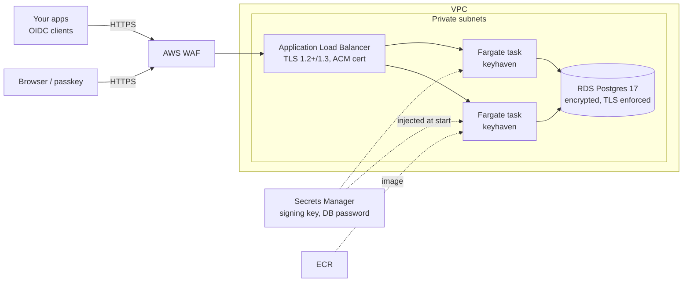

# Keyhaven

An open source, **passkey-first identity provider**: a FIDO2 / WebAuthn server and an
OpenID Connect provider in one small Go binary, with Terraform to run it on
**AWS ECS Fargate**.

Users sign up and sign in with passkeys only (Touch ID, Face ID, Windows Hello, Android,
YubiKeys and other security keys). Your applications sign users in with standard OpenID Connect, so
they work with any OIDC library (NextAuth/Auth.js, Spring Security, `oauth2-proxy`,
AWS ALB/Cognito federation, Grafana, etc.).

## Features

**FIDO2 / WebAuthn relying party**
- Passkey registration and username-less (discoverable) sign-in
- User verification required: the passkey is a full, phishing-resistant credential on its own
- Multiple passkeys per account; add, list and remove them (removing the last one is blocked)
- Signature-counter clone detection (sign-in is rejected if a counter goes backwards)
- Built on [`go-webauthn/webauthn`](https://github.com/go-webauthn/webauthn)

**OpenID Connect provider**
- Authorization code flow with **mandatory PKCE (S256)** for every client, per OAuth 2.1
- Confidential clients (`client_secret_basic`, `client_secret_post`) and public clients (SPA/native)
- ES256-signed ID tokens and RFC 9068 JWT access tokens; JWKS published
- Refresh tokens (via the `offline_access` scope) that rotate on every use
- Discovery, `userinfo`, RP-initiated logout (`end_session`), `prompt=none|login`
- RFC 9207 `iss` parameter on authorization responses

**Admin console** (`/admin`)
- Onboard applications through a guided form. The client secret is shown once, alongside copy-paste integration settings
- Edit redirect URIs, rotate secrets, delete applications
- Browse and search all users, inspect their passkeys, sign them out everywhere, grant or remove admin, delete accounts
- Dashboard with counts and recent activity, plus a filterable audit log of sign-ups, sign-ins and every admin action
- Only administrators can get in, and they must have signed in with a passkey within the last hour. Every change is CSRF-protected, and the system refuses to remove its last administrator

**Operations**
- Stateless app tasks; all state lives in Postgres, so it scales out horizontally
- Migrations run automatically at startup (guarded by an advisory lock)
- Structured JSON logs, `/healthz`, graceful shutdown on SIGTERM
- Distroless, non-root, read-only-filesystem container

## Architecture



| Path | Purpose |
|---|---|
| `cmd/keyhaven` | CLI: `serve`, `migrate`, `genkey`, `client …`, `user …` |
| `internal/server` | HTTP handlers: WebAuthn, OIDC, user pages and the admin console |
| `internal/store` | Postgres persistence and embedded SQL migrations |
| `internal/tokens` | ES256 JWT signing and verification, JWKS |
| `web/` | Embedded HTML templates, CSS and the WebAuthn browser client |
| `deploy/terraform` | VPC, ALB, ACM, ECS Fargate, RDS, Secrets Manager, ECR, WAF |

## Run locally

With Docker:

```sh
docker compose up --build
open http://localhost:8080        # create an account with a passkey
```

Without Docker (Go 1.27+ and PostgreSQL installed, e.g. `brew install postgresql@17`):

```sh
make db      # starts a local Postgres in .devdb/ (port 55433)
make run     # http://localhost:8080
```

> Browsers allow WebAuthn on `http://localhost`. Anywhere else requires HTTPS, and the
> RP ID must be a domain name, not an IP address.

Then make your account an administrator and open the admin console:

```sh
make admin NAME=<your-username>
open http://localhost:8080/admin
```

### Tests

```sh
go test ./...    # unit tests
make e2e         # end-to-end tests against the keyhaven_test database from `make db`
```

The end-to-end tests (`internal/server/e2e_test.go`) use a software FIDO2 authenticator
to drive the real handlers through these steps: sign-up, sign-in, authorize → code → token →
userinfo, and refresh rotation. It also checks the attack cases: wrong PKCE verifier, reused
code, wrong client secret, cloned authenticator, cross-origin POST, unregistered redirect
URI, and an ID token presented as an access token. A second test covers the admin console:
access control, onboarding, secret rotation, user management, re-authentication, unsafe redirects
and the audit log. **The tests drop and recreate the `public` schema, so point them only at a
throwaway database.**

## Configuration

All configuration comes from environment variables.

| Variable | Default | Description |
|---|---|---|
| `KEYHAVEN_ISSUER` | — (required) | Public origin, e.g. `https://id.example.com`. Used as the OIDC issuer and the WebAuthn origin. |
| `KEYHAVEN_SIGNING_KEY` | — (required unless dev) | P-256 private key PEM. Generate with `keyhaven genkey`. |
| `KEYHAVEN_DATABASE_URL` | — | Postgres URL. Alternatively set `DB_HOST`, `DB_PORT`, `DB_NAME`, `DB_USER`, `DB_PASSWORD`, `DB_SSLMODE`. |
| `KEYHAVEN_RP_ID` | issuer host | WebAuthn RP ID. Set it to a parent domain (e.g. `example.com`) so passkeys also work on sibling subdomains. **Changing it later invalidates every existing passkey.** |
| `KEYHAVEN_RP_DISPLAY_NAME` | `Keyhaven` | Name shown on pages and in passkey prompts |
| `KEYHAVEN_RP_EXTRA_ORIGINS` | — | Extra comma-separated WebAuthn origins |
| `KEYHAVEN_ALLOW_SIGNUP` | `true` | Allow self-service account creation |
| `KEYHAVEN_SESSION_TTL` | `12h` | Browser session lifetime at the IdP |
| `KEYHAVEN_ACCESS_TOKEN_TTL` | `15m` | |
| `KEYHAVEN_ID_TOKEN_TTL` | `15m` | |
| `KEYHAVEN_REFRESH_TOKEN_TTL` | `720h` | |
| `KEYHAVEN_ADMIN_REAUTH` | `1h` | Maximum session age for the admin console; older sessions must sign in with a passkey again |
| `KEYHAVEN_LISTEN_ADDR` | `:8080` | |
| `KEYHAVEN_DEV` | `false` | Allows an `http://` issuer and an ephemeral signing key. Never use in production. |

## Admin console

Administrators manage Keyhaven at `https://<your-domain>/admin`.

**Bootstrapping the first administrator.** Sign up normally with a passkey, then grant the role from the
CLI. On Fargate, run it as a one-off task (see [Admin tasks on Fargate](#admin-tasks-on-fargate)):

```sh
keyhaven user promote <username>
```

After that, admins can promote others from the console. To lock sign-up down to people you've
invited, set `allow_signup = false` once your admins exist.

| Page | What you can do |
|---|---|
| Dashboard | Counts of users, applications, passkeys and active sessions; newest users; recent activity |
| Applications | Onboard an app (web app with a secret, or a public SPA/native app using PKCE); view integration settings; edit redirect URIs; rotate the secret; delete |
| Users | Search and page through all users; view a user's passkeys and activity; sign them out everywhere; remove a passkey; grant or remove admin; delete the account |
| Audit log | Every sign-up, sign-in, blocked sign-in, passkey change and admin action, with actor, target, details and IP |

Safeguards: admins can't delete or demote themselves, the last administrator can't be removed, and
destructive actions require typing the user's or application's name to confirm.

## Connect an application

Discovery document: `https://id.example.com/.well-known/openid-configuration`

1. Register the client in the admin console under **Applications → Add an application** (or with the CLI,
   locally or as a one-off ECS task):
   ```sh
   keyhaven client create --name "My App" \
     --redirect-uri https://app.example.com/callback \
     --post-logout-uri https://app.example.com/
   ```
   Add `--public` for SPAs and native apps; public clients get no secret and rely on PKCE.
2. Configure your OIDC library with the issuer, `client_id`, `client_secret` and scopes
   `openid profile` (add `offline_access` for refresh tokens).
3. Make sure PKCE (S256) is enabled in the library. Keyhaven rejects requests without it.

ID token / userinfo claims: `sub` (stable opaque user ID), and with the `profile` scope also
`name` and `preferred_username`. The `amr` claim is `["hwk","user"]`.

## Deploy to AWS Fargate

Prerequisites: an AWS account, a Route 53 hosted zone for your domain, Terraform ≥ 1.6,
Docker with buildx, and the AWS CLI.

```sh
cd deploy/terraform
cp example.tfvars terraform.tfvars      # set domain_name, hosted_zone_id, region
terraform init

# 1. Create the image repository first
terraform apply -target=aws_ecr_repository.this
REPO=$(terraform output -raw ecr_repository_url)

# 2. Build and push an arm64 image (tasks run on Graviton)
aws ecr get-login-password | docker login --username AWS --password-stdin "${REPO%%/*}"
docker buildx build --platform linux/arm64 -t "$REPO:v0.1.0" --push ../..

# 3. Create everything else
terraform apply
```

After about 10–15 minutes (most of it RDS and certificate validation), `https://<domain_name>` is live.

**What gets created:** a VPC across 2 AZs with private subnets for the tasks and database,
NAT for outbound traffic, an ALB with an ACM certificate (HTTP → HTTPS redirect, TLS 1.3 policy, invalid
headers dropped), Route 53 A/AAAA aliases, an ECS cluster with Container Insights, a
Fargate service (desired 2, CPU autoscaling, deployment circuit breaker with rollback),
RDS Postgres 17 (encrypted, TLS enforced, automated backups, master password managed by
RDS in Secrets Manager), the signing key in Secrets Manager, ECR with immutable tags and scan-on-push,
and a WAF with AWS managed rules and a per-IP rate limit.

### Deploying a new version

```sh
docker buildx build --platform linux/arm64 -t "$REPO:v0.2.0" --push .
terraform apply -var image_tag=v0.2.0
```

ECS performs a rolling deployment and rolls back automatically if new tasks fail
health checks.

### Admin tasks on Fargate

The image has no shell, so admin commands run as one-off tasks using the service's task
definition and network:

```sh
terraform output -raw register_client_command   # prints a ready-to-edit aws ecs run-task command
```

The client secret is printed to the task's CloudWatch logs (`/ecs/keyhaven`). Copy it
out, then delete that log stream. Other commands work the same way: `user promote USERNAME`,
`client list`, `client delete ID`, `user list`, `user delete ID`. Once an administrator exists, the
admin console covers all of these.

### Signing key

By default Terraform generates the ES256 key and stores it in Secrets Manager, which
means the key **is also in Terraform state**. Use an encrypted S3 backend with
restricted access (see `versions.tf`). To keep the key out of state, set
`generate_signing_key = false` and populate the secret yourself:

```sh
aws secretsmanager put-secret-value --secret-id keyhaven/signing-key \
  --secret-string "$(keyhaven genkey)"
```

### Rough cost (us-east-1, defaults)

About $90–110/month: 2 small Fargate ARM tasks, a db.t4g.micro, one NAT gateway, the ALB
and the WAF. `db_multi_az = true` and `single_nat_gateway = false` add resilience at
extra cost.

## Security notes

- **Passkey-only.** There are no passwords to phish or stuff. Account recovery is
  "add a second passkey" (synced passkeys from Apple, Google or 1Password cover most users). An
  admin can delete an account with `keyhaven user delete` so the user can register again.
- **CSRF:** cookies are `__Host-`, `HttpOnly`, `Secure` and `SameSite=Lax`, and every state-changing
  browser endpoint also requires a matching `Origin` header.
- **Stored secrets are hashed:** sessions, authorization codes, refresh tokens and client
  secrets are stored as SHA-256 hashes of 256-bit random values.
- **Single use:** authorization codes and WebAuthn challenges are consumed atomically
  (`DELETE … RETURNING`), so a replay always fails, even across tasks.
- **Strict CSP** (no inline script), `frame-ancestors 'none'` and HSTS.
- The database connection uses `sslmode=require`. That encrypts the connection inside the VPC but does not
  verify the RDS certificate; add the RDS CA bundle to the image and use `verify-full` if your
  threat model requires it.

## Limitations / roadmap

Not implemented yet. Contributions welcome:

- Email capture and verification, SCIM provisioning
- Signing-key rotation with multiple published keys
- Back-channel logout, token revocation (RFC 7009) and introspection (RFC 7662) endpoints
- Attestation verification against the FIDO Metadata Service (MDS3) to restrict authenticator models
- Pushed authorization requests (PAR), DPoP

## License

MIT. See [LICENSE](LICENSE).
